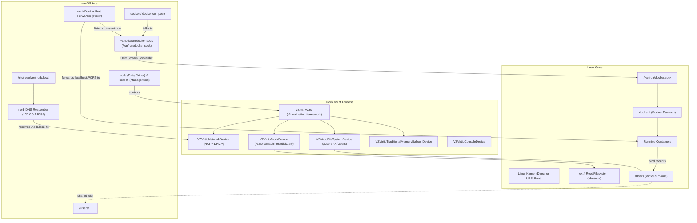

# Norb

**Norb** is a lightweight, zero-overhead macOS virtualization and container engine written in **Rust**, designed as a fast, native open-source alternative to **OrbStack** and **Docker Desktop** on Apple Silicon.

It provides instant Linux machines across multiple distributions, seamless Docker engine integration, 1:1 bidirectional `/Users` file sharing via VirtioFS, `.norb.local` DNS resolution, and automatic container port forwarding to `localhost`.

---

## Architecture Overview



---

## Key Capabilities

| Feature | Norb | OrbStack | Docker Desktop |
| :--- | :--- | :--- | :--- |
| **Language & Engine** | 100% **Rust** + Apple Silicon native | Rust + Swift | Electron + Go |
| **Interface** | **Pure CLI-first** (`norb`, `norbctl`) | GUI + CLI (`orb`, `orbctl`) | Heavy Electron GUI |
| **Memory Footprint** | Extremely low (< 15 MB) | ~50 MB GUI | 500 MB – 2 GB |
| **Startup Time** | **< 1 second** | ~2 seconds | 20–40 seconds |
| **File Sharing** | **VirtioFS** (`/Users` $\rightarrow$ `/Users`) | Custom VirtioFS / NFS | gRPC-FUSE / VirtioFS |
| **Docker Engine** | Drop-in context (`~/.norb/run/docker.sock`) | Drop-in socket | Drop-in socket |
| **Port Forwarding** | **Automatic** `localhost:PORT` proxy | Automatic | Automatic |
| **Local DNS** | `<machine>.norb.local` | `<machine>.orb.local` | `host.docker.internal` |
| **Disk Cloning** | **Instant APFS CoW** snapshot (`/bin/cp -c`) | APFS CoW | Manual export |

---

## CLI Design: `norb` and `norbctl`

Norb mirrors the exact user experience of OrbStack's `orb` and `orbctl`:

### 1. Daily Driver: `norb`
- **Interactive Shell**: Run `norb` with no arguments to drop directly into an interactive shell in your default Linux machine.
- **Transparent Command Execution**: Run any command directly:
  ```bash
  norb uname -a
  norb cat /etc/os-release
  norb -m debian-test -u root uname -a
  ```
- **Custom Usage Help**: Run `norb -h` or `norb help` for the 3-way daily driver guide.

### 2. Management & Administration: `norbctl`
- **Linux Machine Management**:
  ```bash
  norbctl create debian my-box   # Create machine (Debian 12, Alpine, etc.)
  norbctl list                  # List all machines with IP, CPU, RAM, Disk
  norbctl start my-box          # Start a machine
  norbctl stop my-box           # Graceful stop
  norbctl restart my-box        # Quick reboot
  norbctl clone my-box my-clone # Instant APFS CoW snapshot clone (<0.05s)
  norbctl rename old-name new   # Rename machine
  norbctl default my-box        # Get or set default machine
  norbctl ssh my-box            # Show SSH details or connect
  norbctl logs my-box -f        # View or follow console log
  norbctl push ./local /remote  # Stream file to Linux
  norbctl pull /remote ./local  # Stream file from Linux
  norbctl delete my-box         # Remove machine and storage
  ```
- **Docker Integration**:
  ```bash
  norbctl docker setup          # Configure macOS docker CLI context
  norbctl docker status         # Verify Docker engine health
  ```
- **Engine Diagnostics & Services**:
  ```bash
  norbctl doctor                # Comprehensive system & health diagnostics
  norbctl top                   # Live terminal resource monitor
  norbctl daemon start          # Start background DNS and port forwarder
  norbctl daemon status         # Inspect daemon status
  norbctl dns setup             # Setup native /etc/resolver/norb.local
  ```

---

## Installation & Setup

1. Run the installation script:
   ```bash
   ./install.sh
   # or
   make install
   ```
2. The script compiles the workspace in release mode, installs `norb` and `norbctl` into `~/.cargo/bin`, and signs them with Apple's `com.apple.security.virtualization` entitlement.

---

## License

MIT
