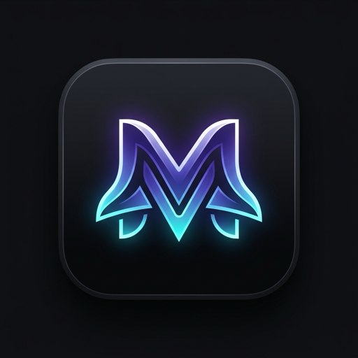

<div align="center">
  
  <h1>Mach</h1>
  <p>Linux virtual machines and container integration for Apple Silicon Macs.</p>
</div>

Mach uses Apple's Virtualization.framework through Rust and Objective-C. It provides a Linux command runner, machine lifecycle commands, and optional Docker and Kubernetes services. Low overhead and interface parity with OrbStack are project goals; no reproducible performance comparison is published here.

### Installation

Requires an Apple Silicon Mac running macOS Sonoma or later. The packaging script creates a local distribution archive; `./install.sh --sync-tap` also synchronizes a local Homebrew tap. Release definitions use GitHub release archives. A release is installable through Homebrew only after its archive is published and the tap definitions are synchronized; a local build alone does not publish it.

From a source checkout with the Rust toolchain and Apple command line tools installed:

```bash
./install.sh
```

This builds and signs the executable with virtualization entitlements, installs development binaries in `~/.cargo/bin`, and packages the distribution. Check `command -v mach` and `mach --version` to confirm which installation your shell uses.

### First use

```bash
mach                         # Prepare a default Debian VM if needed, then open a shell
mach uname -a                # Run a Linux command
mach -m debian -u root whoami
machctl create ubuntu dev    # Create a separate Ubuntu machine named dev
machctl list                 # Configured allocations and machine status
```

First use may download a cloud image, create a disk, boot Linux, and wait for SSH. It requires network access and takes longer than connecting to an already running VM. Machine creation defaults to Ubuntu when no distribution is specified; automatic first-use onboarding creates Debian.

### Docker and Kubernetes

```bash
machctl docker start
# With the host Docker CLI installed:
docker --context mach ps
docker --context mach run --rm --name web -p 8080:80 nginx:alpine
# From another terminal: curl http://localhost:8080
machctl docker status

machctl k8s enable
# With kubectl installed:
kubectl --context mach get nodes
machctl k8s disable
```

Docker and K3s use the protected `mach-system` infrastructure VM. Docker uses dockerd; K3s uses its own containerd. Images built in Docker are not automatically available in Kubernetes. Published Docker TCP ports are forwarded by the background daemon; domain routing and TLS depend on the daemon and macOS resolver/trust configuration. Use `machctl doctor`, `machctl daemon status`, and `machctl dns status` to diagnose integration failures.

`mach docker ...` runs the guest's Docker command in the selected user machine. Use the host `docker --context mach ...` for the infrastructure engine and `machctl docker ...` to manage it.

### Command boundaries

`mach` opens a Linux shell or runs a guest command. It reserves basic machine lifecycle verbs (`start`, `stop`, `restart`, `shell`, `create`, `delete`, `list`/`ls`) and `menu`. Use `-w DIR` to choose a guest working directory. Otherwise a shared host working directory under `/Users` is used when present in the guest, falling back to the guest home directory. Use `mach -- <command> ...` to run a guest executable whose name is reserved locally. Arguments are passed literally; quote a guest shell command explicitly with `mach sh -c '...'` when shell expansion is needed. Administration belongs to `machctl`:

```bash
machctl top
machctl inspect dev --json
machctl clone dev dev-backup
machctl docker logs -n 50
machctl doctor
```

Host `/Users` sharing uses VirtioFS. Guest access therefore includes host files; treat guest commands as having access to those shared files. APFS cloning can share disk blocks, but subsequent writes consume storage. Guest RAM allocations, VM processes, and background services all contribute to total host memory use.

Run `mach --help`, `machctl --help`, or a command's `--help` for options. Unix documentation is installed as `man mach` and `man machctl`.

### Development and validation

Read [AGENTS.md](AGENTS.md) before changing the project. Build and sign with `./install.sh`; validate with `cargo test --workspace`, `./tests/test_cli_primitives.sh`, and `./tests/test_real_deal.sh`. Live tests create machines and require a working macOS virtualization environment. A passing typecheck alone does not establish that VM boot, NAT, Docker forwarding, or Rosetta works.

MIT License.
